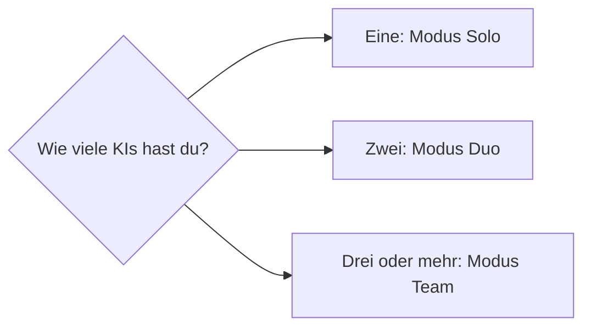
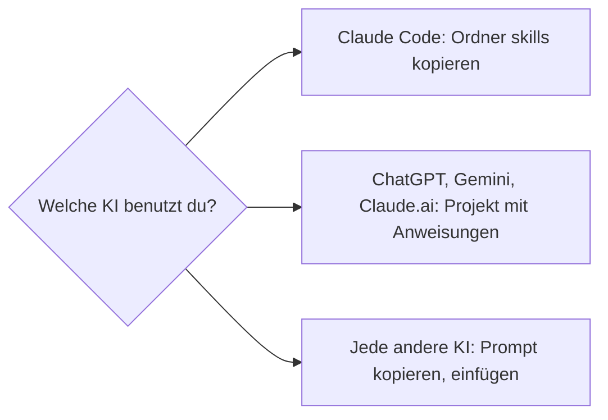
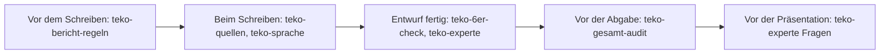

# Anleitung: das Paket einbauen und benutzen

Diese Anleitung führt dich Schritt für Schritt durch das Paket. Du brauchst kein Vorwissen über Skills oder Prompts.
Lies zuerst Abschnitt 1. Wähle dann in Abschnitt 2 den Modus (eine, zwei oder mehr KIs) und richte erst danach in
Abschnitt 3 deine KI oder deine KIs ein.

## 1 Vorbereitung

1. **Bericht bereitlegen.** Am besten als PDF, so wie ihn der Experte sieht. Ein einzelnes Kapitel geht auch.
2. **Schuldokumente bereitlegen.** Die Anleitung Technischer Bericht und das Bewertungsraster deiner Schule. Die KI
   arbeitet mit einer Zusammenfassung, aber bei einer Unklarheit schaust du im Original nach.
3. **Vertraulichkeit klären.** Enthält dein Bericht Firmendaten, frag deine Firma, ob du ihn einer Cloud-KI geben darfst
   (siehe [HINWEIS.md](HINWEIS.md)).
4. **Ordner für die Ergebnisse anlegen.** Zum Beispiel `pruefung/` mit einem Unterordner je Datum. Dort speicherst du jedes
   Gutachten und den Chat-Verlauf. Das brauchst du später für die KI-Deklaration.

## 2 Den Modus wählen



### 2.1 Solo: eine KI

Die KI spielt alle Rollen nacheinander. Das spart Aufwand, aber eine KI übersieht ihre eigenen Fehler leichter. Darum
gelten zwei Regeln besonders streng: Jeder Befund braucht ein wörtliches Zitat mit Seite, und am Schluss gibt es einen
zweiten Durchgang, in dem die KI ihre eigenen Befunde angreift.

So gehst du vor:

1. Neuen Chat öffnen. Den Text der Kopiervorlage einfügen (Datei aus `prompts/`, zum Beispiel `teko-experte.md`, alles
   zwischen `--- ANFANG ---` und `--- ENDE ---`), Bericht anhängen, abschicken.
2. Wenn das Gutachten da ist, im selben Chat schreiben:
   «Zweiter Durchgang: Greife jetzt jeden deiner Befunde an. Steht das Zitat wirklich so im Text? Ist der Befund falsch,
   übertrieben oder schon an einer anderen Stelle beantwortet? Gib eine Liste ‹bleibt› und ‹verworfen, weil …›.»
3. Du prüfst jeden Befund aus der Liste «bleibt» selbst an der genannten Seite. Hat die KI im zweiten Durchgang gar
   nichts verworfen, lass sie ein zweites Mal streng prüfen: Eine leere Verworfen-Liste ist ein Warnzeichen.
4. Gutachten und Chat-Verlauf speichern.

### 2.2 Duo: zwei KIs

Zwei verschiedene KIs können Verschiedenes übersehen [Schlussfolgerung, eigene Erfahrung]. Die zweite KI ist der
Gegenprüfer.

1. KI 1 prüft den Bericht mit der Kopiervorlage (wie bei Solo, Schritt 1).
2. Du gibst KI 2 den Bericht, die Kopiervorlage und das Gutachten von KI 1, dazu den Satz aus
   `vorlagen/BRIEF_AN_PRUEFER.md`, Teil «Gegenprüfung»: «Hier sind die Befunde eines anderen Prüfers. Widersprichst du?
   Welcher Befund ist falsch, und was hat er übersehen? Jede Aussage mit Zitat und Seite.»
3. Wo sich die beiden widersprechen, entscheidest du am Original. Nicht die Mehrheit zählt, sondern das Zitat.
4. Beide Gutachten und beide Chat-Verläufe speichern.

### 2.3 Team: drei oder mehr KIs

Jede KI bekommt eine Rolle. Ein Chef gleicht die Ergebnisse ab. Der Chef kannst du sein oder eine KI, der du alle
Antworten gibst.

| Rolle | Aufgabe | passender Skill |
|---|---|---|
| Experte | Punkte nach Raster schätzen, Schwächen, Prüfungsfragen | `teko-experte` |
| Formprüfer | Aufbau, Abstract, Format, Verzeichnisse, die 20 Prüfpunkte | `teko-bericht-regeln`, `teko-6er-check` |
| Quellenprüfer | Zitate, Literaturverzeichnis, KI-Deklaration | `teko-quellen` |
| Sprachprüfer | KI-Klang, Verständlichkeit, roter Faden | `teko-sprache` |
| Rechner | jede Zahl im Bericht nachrechnen (Summen, Prozent, Mittelwerte) | `teko-gesamt-audit`, Rolle «Rechner» |
| zweiter Experte | greift die Befunde der anderen an | `teko-experte`, `teko-team-lehren` |

Ablauf: Rollen verteilen, alle prüfen unabhängig (keine KI sieht vorher die Antwort der anderen), der Chef prüft jeden
Befund am Original, führt eine Liste «verworfen, weil …» und schreibt das Gutachten nach `vorlagen/GUTACHTEN_VORLAGE.md`.
Wie das genau geht, steht im Skill `teko-gesamt-audit`.

## 3 Einbau je KI

**Was getestet ist (Stand Version 1.0):** Die Kopiervorlage `teko-gesamt-audit.md` wurde mit einer einzigen KI (Gemini) am
Übungsbericht geprüft: zwölf von zwölf eingebauten Fehlern gefunden. Die Einbauwege 3.1 bis 3.5 sind nach den
Hilfeseiten der Hersteller beschrieben, aber nicht einzeln ausprobiert. Mach darum nach dem Einbau zuerst einen
Trockenlauf mit `uebung/UEBUNGSBERICHT.md` und vergleiche mit `uebung/SCHLUESSEL.md`.



Es gibt zwei Wege. Bei Claude Code liegen die Skills als Ordner auf deinem Computer, und die KI lädt den passenden Skill
selbst. Bei allen anderen KIs kopierst du eine Datei aus `prompts/` in den Chat oder hinterlegst sie dauerhaft in einem
Projekt.

**Projekt-Anweisung (für ChatGPT, Claude.ai, Gemini, Copilot).** Wo du ein Projekt, ein Gem oder ein Notebook anlegst,
fügst du als Anweisung diesen kurzen Text ein und lädst `prompts/ALLE_SKILLS.md` als Datei hoch:

```
Du prüfst meine TEKO-Diplomarbeit nach den Regeln in der Datei ALLE_SKILLS.md. In jedem Chat sage ich dir, welchen
Teil du anwendest (zum Beispiel teko-experte) und welchen Modus (Solo, Duo oder Team). Jeder Befund braucht eine
Fundstelle und ein wörtliches Zitat aus meinem Bericht. Du schreibst meine Arbeit nicht, du prüfst sie. Antworte auf
Deutsch, in einfachen Sätzen.
```

Einen Chat startest du dann so: Bericht anhängen und zum Beispiel schreiben «Prüfe das angehängte PDF mit teko-experte,
Modus Solo» oder «Gesamt-Audit nach teko-gesamt-audit, Modus Solo».

Die Menüwege unten stammen aus den Hilfeseiten der Hersteller, Stand 06.10.2026. Menüs ändern sich oft. Findest du
einen Knopf nicht, öffne die verlinkte Hilfeseite.

### 3.1 Claude Code (Programm auf deinem Computer)

1. Kopiere die sieben Ordner aus `skills/` nach `~/.claude/skills/` (gilt dann für alle deine Projekte) oder nach
   `.claude/skills/` in deinem Projektordner (gilt nur dort). Jeder Ordner enthält eine Datei `SKILL.md`.
2. Starte Claude Code neu.
3. Sag in normalen Worten, was du willst, zum Beispiel «prüfe Kapitel 4 wie ein TEKO-Experte». Claude lädt den passenden
   Skill selbst. Du kannst ihn auch beim Namen nennen: «benutze teko-gesamt-audit».

Hilfe: [Extend Claude with skills](https://code.claude.com/docs/en/skills)

### 3.2 Claude.ai (im Browser)

- **Als Skill:** Einstellungen → Capabilities → Codeausführung einschalten. Dann Customize → Skills → «+» → Upload a
  skill. Hochladen kannst du je Skill eine ZIP-Datei aus `dist/skills-zip/` (der Ordnername in der ZIP muss gleich heissen
  wie der Skill, das ist schon so). Geht laut Hilfe auch in der Gratisversion.
- **Als Projekt:** Projects → New Project. Unter «Set project instructions» die Projekt-Anweisung von oben einfügen,
  als Projektwissen `prompts/ALLE_SKILLS.md` hochladen. Gratis höchstens fünf Projekte.

Hilfe: [Use skills in Claude](https://support.claude.com/en/articles/12512180-use-skills-in-claude),
[What are projects?](https://support.claude.com/en/articles/9517075-what-are-projects)

### 3.3 ChatGPT

1. Seitenleiste → New project, Name zum Beispiel «Diplomarbeit prüfen».
2. Im Projekt über das Menü (drei Punkte) → Project settings: die Projekt-Anweisung von oben einfügen.
3. Als Dateien hochladen: `prompts/ALLE_SKILLS.md` und deinen Bericht. In der Gratisversion sind laut Hilfe nur fünf
   Dateien je Projekt erlaubt. Darum gibt es `ALLE_SKILLS.md`: alle sieben Skills in einer einzigen Datei.
4. Jeden neuen Chat in diesem Projekt starten, den Bericht anhängen und sagen, welcher Teil gilt, zum Beispiel
   «Prüfe das angehängte PDF mit teko-experte, Modus Solo». Die Regeln musst du nicht mehr kopieren.

Eigene GPTs (Custom GPTs, also selbst gebaute ChatGPT-Assistenten) lassen sich laut Hilfe mit einem privaten Konto nicht mehr neu anlegen. Nimm das Projekt.

Hilfe: [Projects in ChatGPT](https://help.openai.com/en/articles/10169521-projects-in-chatgpt)

### 3.4 Google Gemini

- **Als Skill (neu):** gemini.google.com → Settings → Skills → Upload. Gemini nimmt eine `SKILL.md`, einen Ordner oder eine
  ZIP mit `SKILL.md` im Hauptordner, also genau die Dateien aus `skills/` oder `dist/skills-zip/`. Laut Hilfe nur für
  private Google-Konten ab 18 Jahren und noch nicht für Schul- oder Firmenkonten.
- **Als Gem** (ein gespeicherter Gemini-Assistent mit eigener Anweisung): Seitenleiste → Gems → New Gem. Als Anweisung die Projekt-Anweisung von oben einfügen, unter Knowledge
  `prompts/ALLE_SKILLS.md` hochladen. Laut Hilfe werden Gems auf privaten Konten ab November 2026 zu Skills.

Hilfe: [Skills in Gemini](https://support.google.com/gemini/answer/17094296),
[Gems](https://support.google.com/gemini/answer/15146780)

### 3.5 Microsoft Copilot

- **Mit Microsoft 365 Copilot** (Firmen- oder Schullizenz, laut Hilfe auch Microsoft 365 Personal, Family, Premium und Pro): ein Notebook (eine Sammelmappe mit Anweisung und Dateien) anlegen, unter Instructions die Projekt-Anweisung
  von oben einfügen und `prompts/ALLE_SKILLS.md` sowie deinen Bericht als Referenz hinzufügen. Oder einen Agent mit
  denselben Anweisungen bauen.
- **Gratis-Copilot:** Dort gibt es laut Hilfe keinen dauerhaften Speicher für Anweisungen mit Dateien. Nimm den Weg 3.6.

Hilfe: [Notebook-Anweisungen](https://support.microsoft.com/en-us/microsoft-365-copilot/provide-custom-instructions-for-your-microsoft-365-copilot-notebook)

### 3.6 Jede KI: Prompt kopieren (der schnellste Weg)

1. Öffne die passende Datei in `prompts/` mit einem Texteditor.
2. Kopiere alles zwischen den Linien `--- ANFANG ---` und `--- ENDE ---` in einen neuen Chat.
3. Hänge deinen Bericht oder ein Kapitel an und schicke ab.

Das funktioniert überall, wo man Text und eine Datei schicken kann, und ist der schnellste Weg für einen ersten Versuch
(so beginnt auch der Schnellstart im README). Der Nachteil: Du wiederholst es in jedem neuen Chat. Wenn du das Paket
öfter brauchst, lohnt sich ein Projekt (3.2 bis 3.5).

## 4 Die sinnvolle Reihenfolge



1. **Vor dem Schreiben:** `teko-bericht-regeln` einmal ganz lesen lassen und fragen: «Stimmt meine Gliederung mit der
   TEKO-Reihenfolge überein?»
2. **Beim Schreiben:** nach jedem Kapitel `teko-sprache` und, wenn Quellen drin sind, `teko-quellen`.
3. **Wenn ein Entwurf steht:** `teko-6er-check` für die 20 Prüfpunkte, dann `teko-experte` für die Punkte-Schätzung.
4. **Ein bis zwei Wochen vor der Abgabe:** `teko-gesamt-audit` über den ganzen Bericht. Dann bleibt Zeit, die Liste
   abzuarbeiten.
5. **Vor der Präsentation:** `teko-experte` im Modus «Fragen üben». Eine Frage nach der anderen, du antwortest, die KI
   bewertet.

## 5 Das Ergebnis lesen

Jedes Gutachten hat dieselbe Form (`vorlagen/GUTACHTEN_VORLAGE.md`):

- **Befunde** mit Fundstelle, Zitat und Schwere. Prüfe jeden selbst. Ein Befund ohne Zitat zählt nicht.
- **Verworfen**: Befunde, die beim Nachprüfen nicht gestimmt haben, mit Grund. Diese Liste ist wichtig. Sie zeigt, dass
  geprüft und nicht nur gesammelt wurde.
- **Liste A**: was du sofort selbst verbessern kannst.
- **Liste B**: was erst geht, wenn deine letzten Ergebnisse da sind.
- **Liste C**: was du mit deinem Betreuer oder deiner Firma klären musst.
- **Punkte-Schätzung** je Bewertungsbereich und eine **Notenspanne**: Die KI rechnet die Berichtpunkte mit drei
  Annahmen für Präsentation, Arbeitsweise und Onlinepublikation in eine Note um (Note = Punkte ÷ 180 × 5 + 1, bestanden
  ab 4,0, das sind 107 Punkte). Eine Orientierung, keine Note.

Arbeite die Listen mit `vorlagen/ABHAKLISTE.md` ab. Nach grösseren Änderungen prüfst du neu: Jede Änderung kann an einer
anderen Stelle einen neuen Widerspruch erzeugen.

## 6 Präsentation üben

Mit `teko-experte` und `vorlagen/FRAGEN_TRAINING.md`:

1. Die KI stellt eine Frage, wie am Prüfungstag: zuerst breit, dann zur Methode, dann an die Grenze deiner Arbeit, dann
   eine Verständnisfalle.
2. Du antwortest so, wie du es mündlich sagen würdest.
3. Die KI sagt, ob das eine gute Antwort war, was die Frage eigentlich wissen wollte, und hilft dir, eine kurze Antwort in
   drei Sätzen zu bauen: Kernaussage, Nachweis (mit Zahl oder Seite), ehrliche Grenze.

Lerne die Antworten nicht auswendig. Du sollst sie in deinen eigenen Worten sagen können.

## 7 Häufige Probleme

| Problem | Was hilft |
|---|---|
| Die KI lobt alles. | Schreib: «Du bist der strenge Experte, nicht mein Assistent. Nenne die drei schwächsten Stellen mit Zitat.» |
| Die KI erfindet ein Zitat oder eine Seite. | Befund verwerfen. Schreib: «Dieses Zitat steht nicht auf Seite X. Prüfe alle Befunde noch einmal am Text.» |
| Der Bericht ist zu lang für die KI. | Kapitel einzeln prüfen lassen. Das Abstract und das Inhaltsverzeichnis jedes Mal mitgeben, damit die KI das Ganze kennt. |
| Zwei KIs sagen das Gegenteil. | Nicht abstimmen. Am Original entscheiden. Das Zitat gewinnt. |
| Die KI kennt die Schulregeln nicht. | Kopiervorlage `prompts/teko-bericht-regeln.md` zusätzlich mitgeben. |
| Das Gutachten widerspricht sich selbst (ein Punkt heisst «erfüllt», obwohl es dazu einen Befund gibt). | Schreib: «Prüfe den Stand der 20 Punkte gegen deine eigenen Befunde und korrigiere die Widersprüche.» |
| Nach einer Korrektur stimmt etwas anderes nicht mehr. | Jede Zahl, die du änderst, im ganzen Bericht suchen (Abstract, Text, Tabelle, Fazit). |

## 8 KI-Nutzung deklarieren

Jede Prüfung mit diesem Paket ist eine KI-Nutzung und gehört in deine Liste der Hilfsmittel. Wie ein Eintrag aussieht,
steht in [HINWEIS.md](HINWEIS.md) und im Skill `teko-quellen`.
