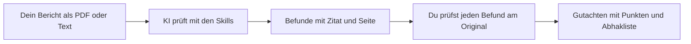
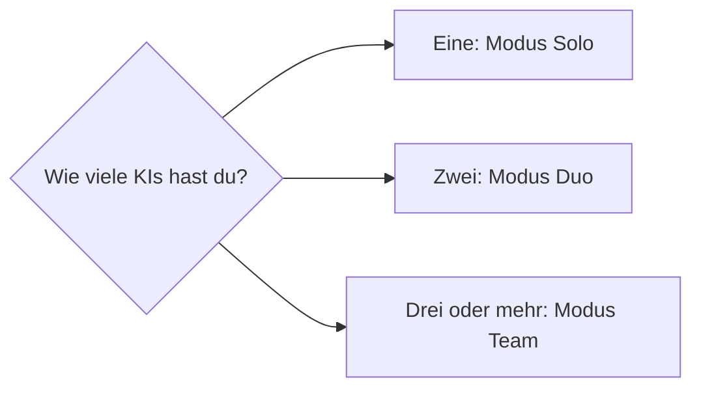
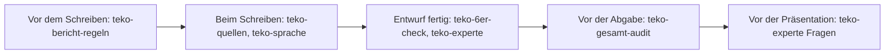

# teko-diplom-kit

Prüfe deine TEKO-Diplomarbeit, bevor es der Experte tut.

Dieses Paket ist eine Sammlung von Anweisungen für KI-Werkzeuge. Jede Anweisung sagt der KI genau, wie sie deinen
Bericht prüfen soll; auf Englisch heissen solche Anweisungen «Skills». Damit liest eine KI deinen Bericht
so, wie ihn ein strenger Fachexperte lesen würde: Sie prüft ihn gegen die TEKO-Vorgaben, schätzt die Punkte nach dem
Bewertungsraster, sucht schwache Stellen und übt mit dir die Fragen für die Präsentation.

Das Paket prüft. Es schreibt deine Arbeit nicht. Jeder Befund kommt mit Fundstelle und wörtlichem Zitat, damit du ihn
selbst am Original kontrollieren kannst.

## Für wen

Für Studierende der TEKO (zum Beispiel Systemtechnik HF), die ihre Diplomarbeit vor der Abgabe prüfen wollen. Du
brauchst nur eine KI. Hast du zwei oder mehr, wird die Prüfung strenger.

## Start in 5 Minuten

1. Speichere deinen Bericht als PDF oder Word-Datei. Enthält er Firmendaten, lies vorher in [HINWEIS.md](HINWEIS.md)
   den Abschnitt «Vertrauliche Daten».
2. Entpacke die ZIP-Datei des Pakets. Öffne darin den Ordner `prompts/` und die Datei `teko-experte.md` mit einem
   Texteditor. Markiere den ganzen Text zwischen `--- ANFANG ---` und `--- ENDE ---`, kopiere ihn und füge ihn in ein
   neues Chatfenster deiner KI ein (zum Beispiel ChatGPT).
3. Hänge deinen Bericht an (oder ein einzelnes Kapitel) und schicke die Nachricht ab.
4. Du bekommst eine grobe Punkte-Schätzung je Bewertungsbereich (keine Note, sie kann deutlich daneben liegen), die
   drei schwächsten Stellen und was ein Experte fragen würde.
5. Prüfe jeden Befund selbst an der genannten Seite. Erst dann änderst du etwas.

Tipp für den ersten Versuch: Gib der KI zuerst den erfundenen Übungsbericht `uebung/UEBUNGSBERICHT.md`. Er hat zwölf
eingebaute Fehler; in `uebung/SCHLUESSEL.md` siehst du, wie viele deine KI gefunden hat.

Benutzt du Claude Code, kopierst du stattdessen den Ordner `skills/` einmal an den richtigen Ort (siehe
[ANLEITUNG.md](ANLEITUNG.md), Abschnitt 3.1). Danach sagst du einfach «prüfe meinen Bericht wie ein Experte».

## So läuft es ab



In Worten: Bericht hinein, die KI prüft, du kontrollierst jeden Befund, am Ende hast du ein Gutachten mit Abhakliste.
(Die Diagramme siehst du als Bild auf GitHub oder in einem Markdown-Programm; in einem einfachen Texteditor erscheinen sie
als Code. Der Text daneben sagt dasselbe.)

## Eine, zwei oder viele KIs



| Modus | Wer prüft | Wie |
|---|---|---|
| Solo | eine KI | Sie spielt Prüfer, Experte und Gegenprüfer nacheinander. Jeder Befund braucht ein wörtliches Zitat. Am Schluss greift sie ihre eigenen Befunde noch einmal an. |
| Duo | zwei KIs | Die erste prüft. Die zweite bekommt den Bericht und die Befunde und sucht, was davon falsch ist. |
| Team | drei oder mehr | Jede KI hat eine Rolle (Rechner, Quellen, Experte, Sprache). Ein Chef, du oder eine KI, gleicht ab und prüft jeden Befund am Original. |

Jeder Skill beschreibt alle drei Modi. Du entscheidest selbst, wie viel Aufwand du willst.

## Die sieben Skills

| Skill | Was er macht | Wann |
|---|---|---|
| `teko-bericht-regeln` | Aufbau, Abstract, Format, Abbildungen, Tabellen, Verzeichnisse nach der TEKO-Anleitung | vor und während dem Schreiben |
| `teko-quellen` | APA 7, Primärquelle vor Sekundärquelle, KI ist keine Quelle, KI-Deklaration | beim Schreiben, vor der Abgabe |
| `teko-sprache` | KI-Klang erkennen, verständliche Sätze, Laientest, roter Faden | nach jedem Kapitel |
| `teko-6er-check` | 20 Prüfpunkte, die die besten Arbeiten gemeinsam haben | wenn ein Entwurf steht |
| `teko-experte` | Experte auf dem leeren Stuhl: Punkte nach Raster, Schwächen, Prüfungsfragen | nach dem Entwurf, vor der Präsentation |
| `teko-gesamt-audit` | der ganze Bericht in einem Durchgang, mit Gutachten und Abhakliste | vor der Abgabe |
| `teko-team-lehren` | Regeln, die Prüffehler verhindern (Zitatpflicht, Gegenprobe und andere) | bei jeder Prüfung im Hintergrund |



`teko-team-lehren` läuft in jedem Schritt mit: Es sind die Regeln, die verhindern, dass eine KI dir einen falschen Befund
als Tatsache verkauft.

## Was im Paket liegt

```
teko-diplom-kit/
  README.md        diese Seite
  ANLEITUNG.md     Einbau je KI, die drei Modi Schritt für Schritt
  HINWEIS.md       Nutzung, KI-Deklaration, keine Gewähr für die Note
  skills/          sieben Skills, je ein Ordner mit SKILL.md
  prompts/         dieselben Skills als Kopiervorlage für jede KI
  vorlagen/        Gutachten, Abhakliste, Brief an einen Prüfer, Fragen-Training
  uebung/          erfundener Übungsbericht, Schlüssel, kommentiertes Beispiel-Gutachten
  dist/skills-zip/ je Skill eine ZIP zum Hochladen (Claude.ai, Gemini)
  CHANGELOG.md     was sich von Version zu Version geändert hat
```

## Wörter, die du kennen musst

| Wort | Bedeutung |
|---|---|
| Skill | eine Anweisung für die KI, wie sie prüfen soll (hier: sieben Stück) |
| Kopiervorlage, Prompt | der Skill als reiner Text, fertig zum Einfügen in einen Chat (Ordner `prompts/`) |
| Bewertungsraster | die Punkte-Tabelle der Schule, nach der deine Arbeit benotet wird |
| Befund | eine Stelle, die die KI bemängelt |
| Fundstelle, Zitat | wo der Befund steht (Seite, Kapitel) und der genaue Wortlaut aus deinem Bericht |
| verworfen | ein Befund, der beim Nachprüfen nicht gestimmt hat |
| Gutachten | die Zusammenfassung aller Befunde mit Punkte-Schätzung und Abhakliste |
| KI-Deklaration | die Angabe im Bericht, wofür du welche KI benutzt hast; die Schule verlangt sie |

## Bevor du anfängst

- Lies [HINWEIS.md](HINWEIS.md). Zwei Punkte sind wichtig: Die TEKO verlangt, dass du jede KI-Nutzung deklarierst, auch
  die Prüfung mit diesem Paket. Und: Enthält dein Bericht vertrauliche Firmendaten, kläre mit deiner Firma, ob du ihn
  einer Cloud-KI geben darfst.
- Massgebend sind immer die aktuellen Dokumente deiner Schule (Anleitung, Bewertungsraster) und dein Betreuer. Das Paket
  fasst sie nur zusammen.
- Die Schritt-für-Schritt-Anleitung steht in [ANLEITUNG.md](ANLEITUNG.md).
